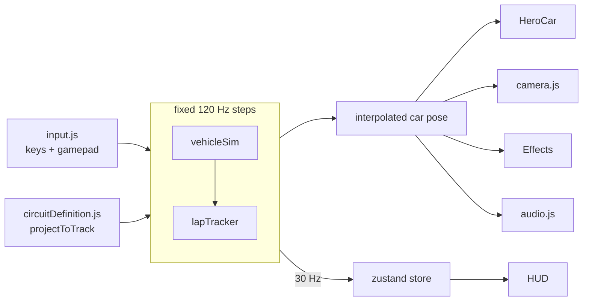

# GiTogether Qualifying 🏁

Made for one of the qualifying rounds of **GiTogether 2026** :)

A racing game that runs in the browser. You get one car, one 4.7 km circuit full of hills, and five laps to set the best time you can. Everything is drawn with Three.js, the physics is written from scratch, and every sound is synthesised live, so there isn't a single audio file in the repo.

It doesn't have a proper name yet. Ideas welcome.

---

## Getting started

You need Node 20 or newer.

```bash
cd car-project
npm install
npm run dev          # → http://localhost:5173
```

The first load takes a few seconds while the terrain and trees are built. After that it should hold 60 fps on a reasonable laptop. If it doesn't, switch Graphics to Medium or Low on the title screen (the game also steps down by itself if the frame rate drops).

Other useful commands:

```bash
npm test             # physics, wall collisions, lap timing, track and scenery checks
npm run lint
npm run build        # production build in dist/
```

## How to play

The loading screen walks you through the controls and throws a few tips at you while the circuit builds. Press any key when it's ready.


- **Start lights.** Five red lights come on one by one, then all go out together at a random moment. The engine is live on the grid, so feel free to rev it. Your reaction time pops up once you're away.
- **The session.** Five laps. Each completed lap shows in the panel at the top left, and your best lap turns purple. The sector bar at the top right shows how each third of the lap compared with your best: purple means a new best, yellow means slower.
- **Live delta.** The green or red number next to your current lap tells you how far ahead of or behind your best lap you are at this exact point on the track.
- **Overtake boost.** Hold `Shift` above 60 km/h for a big shove of electric power. The battery lasts about 8 seconds and recharges when you brake hard, so save it for the long uphill straight.
- **Track limits.** Kerbs are fine, and so is putting two wheels over the white line. Put all four over it and you pick up a strike. The first two strikes in a lap are warnings; the third deletes that lap. A deleted lap still counts as one of your five, but it can't be your best lap or set best sectors, and it shows struck through in the timing tower and the results. Every lap starts with a clean slate. Off the track, grass and gravel are slow and the walls are solid.
- **The menu.** `Esc` opens the pause menu: a summary of your session, plus graphics, camera, sound, assists and a reset-to-track button.

### Controls

| Input | Action |
| --- | --- |
| `W` / `↑` | Throttle |
| `S` / `↓` / `Space` | Brake (hold at a standstill to reverse) |
| `A` / `D` / `←` / `→` | Steer |
| `Shift` / `E` | Overtake boost |
| `C` | Camera: chase → far chase → T-cam |
| `R` | Put the car back on the track |
| `Esc` / `P` | Pause |
| Gamepad | Left stick to steer, RT throttle, LT brake, A or RB to boost |

The driver assists are all on by default: steering help, speed-sensitive steering (calmer steering at high speed, made for keyboards), traction control, ABS and stability control. Turn them off on the title or pause screen if you want more of a challenge.

## The circuit

An original layout with a lot of Spa in its DNA:

1. Flat start straight running into a tight hairpin
2. A downhill run into a compression, then a **left-right-left esses climbing about 20 m**
3. A ~900 m uphill straight to a chicane at the top of the hill
4. Fast descending corners, a double-left, and a long right at the far end
5. A fast sweep into a flowing infield section
6. A back straight to a bus-stop chicane, and onto the line

It's 4.69 km long with about 38 m of elevation change, and the steepest gradient is around 10%. The test bot gets round in about 1:39, and it never uses boost, so beat that.

---

## Architecture

```
car-project/
├── src/racing/
│   ├── RacingGame.jsx        thin shell: <Canvas>, graphics presets, shortcuts, HUD + menus
│   ├── rules.js              session rules: lap count, track-limit warnings
│   ├── store.js              zustand store: game state, telemetry, settings
│   ├── circuitDefinition.js  THE track: spline, projection, kerbs, runoff, geometry
│   ├── audio.js              procedural Web Audio engine
│   ├── sim/                  pure JS: no React, no three.js
│   │   ├── vehicleSim.js     car physics, walls, boost, grid hold
│   │   ├── tyre.js           tyre force curve + friction circle
│   │   ├── drivetrain.js     torque curve, 8-speed gearbox, free-revving
│   │   ├── lapTracker.js     laps, checkpoints, sectors, live delta, track limits
│   │   ├── input.js          keyboard + gamepad → smoothed analog controls
│   │   └── autopilot.js      a simple bot driver (tests and screenshots)
│   ├── scene/                everything 3D
│   │   ├── GameScene.jsx     the frame loop (see below)
│   │   ├── RaceTrack.jsx     road, kerbs, runoff, barriers, fences
│   │   ├── Terrain.jsx       hills that follow the circuit's elevation
│   │   ├── HeroCar.jsx       car model, wheels, suspension, brake lights
│   │   ├── Effects.jsx       skid marks, tyre smoke, sparks
│   │   ├── Lighting.jsx      HDRI sky + sun + fog
│   │   ├── PostFX.jsx        ambient occlusion, bloom, tone mapping, AA
│   │   ├── camera.js         chase / far / T-cam / title orbit
│   │   ├── materials.js      PBR materials with small shader patches
│   │   └── Scenery/          grandstands, pits, gantry, trees, signage
│   └── hud/                  HUD, menus, styles
├── scripts/                  asset pipeline + screenshot tool
├── public/assets/            web-ready textures, sky, trees, car
└── assets-src/               source car model (not served)
```

### How a frame works



`GameScene.jsx` runs once per rendered frame. It reads the controls, then advances the physics in **fixed 120 Hz steps** however fast the screen refreshes, so the car handles the same at 60 Hz, 144 Hz or during a stutter. The car is drawn at a position interpolated between the last two physics steps, which keeps motion smooth. The HUD gets a telemetry snapshot 30 times a second through the zustand store, so HUD updates never re-render the 3D scene.

### The track is the single source of truth

`circuitDefinition.js` defines the circuit as a closed spline through hand-placed control points (x, height, z). Everything else is derived from it:

- **Projection.** `projectToTrack(x, z)` returns how far along the lap a point is, how far it sits from the centreline, which surface it's on, and the road height and gradient underneath. A local search around the last hit keeps it cheap every frame, and a spatial hash handles everything else.
- **Analysis.** From curvature it works out where the kerbs go (corners only), a racing line (the darker rubbered-in strip), and the runoff on each side: gravel outside slow corners, painted asphalt outside fast ones, grass on the straights.
- **Geometry.** Road, kerbs, runoff, lines, barriers and fences are all ribbons built along the spline.

Because physics and rendering read the same data, what you see is what you drive on. If it looks like gravel, it grips like gravel.

### Physics (`sim/`)

The car is a "bicycle model": one front axle and one rear axle, each with a tyre force curve and a friction circle, so braking and cornering share the same grip. On top of that:

- weight shifting front-to-back under braking and acceleration
- downforce and drag that grow with speed²
- an 8-speed gearbox with a torque curve and a short torque cut on each shift
- gravity along slopes; the car goes light over crests and heavy in dips
- a slight grip bias towards the rear, so the car lets go gently instead of spinning
- the overtake battery, and a "held on the grid" mode for the start

Walls are tested at nine points around the car's outline every step. When one goes through, the car is pushed back out and a proper rigid-body impulse at the contact point bounces it off, so you get a realistic glancing hit or spin rather than sliding along a sticky wall.

The `sim/` folder has no React or three.js in it on purpose. It's deterministic and covered by tests, including an autopilot lap of the real circuit and 108 crashes into walls at different angles and speeds.

### Changing the rules (`rules.js`)

The session rules live in one small file, `car-project/src/racing/rules.js`. The lap tracker, HUD and results screen all read from it:

```js
export const RULES = {
  laps: 5,
  trackLimitWarnings: 2,
};
```

- `laps` is the number of laps in a session.
- `trackLimitWarnings` is how many track-limit strikes per lap are let off with a warning. The next strike deletes the lap. Set it to `0` to delete a lap on the first strike, or `null` to turn track limits off.

A strike is the car's centre more than 0.6 m past the white line, which works out to all four wheels over it. One trip wide is one strike however long you stay out there; it re-arms once you're back inside the line.

**Conventions you'll need:** `forward = (-sin yaw, -cos yaw)`, yaw increases when turning left, and `vy` is positive to the left. In `projectToTrack`, a positive `distance` means left of the direction of travel.

### Rendering (`scene/`)

- **Lighting.** A real HDRI sky lights the scene and doubles as the visible sky. The sun was placed by finding the brightest spot in the HDRI, so shadows match the sky.
- **Shadows.** One sharp shadow map follows the car and snaps to whole texels, so shadow edges don't crawl as you drive.
- **Post-processing.** Ambient occlusion (N8AO), bloom for lights, ACES tone mapping and SMAA anti-aliasing.
- **Surfaces.** Standard PBR materials with small shader patches: anti-tiling so you can't spot the texture repeat, the racing line, sharp kerb stripes with a sawtooth rumble, and blended grass, gravel and asphalt runoff.
- **Terrain.** Matches the road height near the circuit, blends into a smoothed version of the circuit's elevation, then becomes rolling hills. The paddock is kept flat.
- **Trees.** About 7,400 of them, drawn as "impostors": each tree was rendered from 8 angles ahead of time, and the game draws a flat card that picks the right angle and re-lights it with baked normals. That's 2 draw calls for the whole forest.
- **Scenery.** Every grandstand, building, mast and tree position lives in `Scenery/layout.js`, built from the track. A test fails if anything ends up too close to the circuit.

### HUD and menus (`hud/`)

The layout takes cues from F1 25, Gran Turismo and Forza:
- **Timing tower (top left):** session tag, lap count, a big current lap time with a live delta pill, then best, last, track-limit warnings and lap history.
- **Sector panel (top right):** three blocks that turn purple or yellow as you complete each sector, with the current one counting live.
- **Dial cluster (bottom right):** battery ring, gear with rev lights, and speed/RPM.

Everything scales with the window.

Menus are frosted-glass cards over the live scene:
- **Pause:** the card grows out of a small glass "lens" in the middle of the screen while the scene behind eases in and blurs. Closing collapses it back into the centre, faster.
- **Everywhere else, the same lens language:**
  - the loading screen dissolves into glass over the circuit, then collapses into the title card
  - the start lights open and close as a lens
  - HUD panels and lap banners grow from their centres, and the track-limits flags ("warning 1 of 2", "lap deleted") pop in and out
  - restarting or resetting the car does a quick glass "refocus" that hides the teleport
  - settings toggles have a sliding glass thumb
  - boost lights up the screen edges, and the results card counts your times up

Motion follows a few simple rules:

- animate only `transform`, `opacity` and `clip-path`, with custom ease-out curves
- buttons press down slightly when clicked
- exits are always faster than entrances, and transitions can be interrupted (spam Esc and it just reverses)

Reduced-motion and reduced-transparency settings are respected.

### Sound (`audio.js`)

Everything is synthesised with the Web Audio API:

- **Engine:** three oscillators at the engine's firing frequency, through soft distortion and a filter that opens with the throttle.
- **Engine details:** a dip on each gearshift, crackles when you lift off at high revs, and an electric whine while boosting.
- **Car sounds:** tyre squeal that follows how much the tyres are actually sliding, wind noise that builds with speed, and kerb rumble.

---

## Asset pipeline (`scripts/`)

You only need these if you change the source assets.

| Script | What it does |
| --- | --- |
| `fetch-assets.mjs` | Downloads the CC0 textures and sky from Poly Haven, converts them to WebP, and measures the sun's direction from the HDRI |
| `bake-impostors.mjs` | Downloads two CC0 tree models and renders them from 8 angles into albedo + normal atlases (needs `npm run dev` running) |
| `prepare-car.mjs` | Builds `public/assets/car/hero.glb` from the source model: separates the wheels (including the parts that steer with them), applies our own livery, compresses it (40 MB → 4.9 MB) |
| `shots.mjs` | Takes screenshots around the circuit with Playwright and reports fps and draw calls (needs `npm run dev` running) |

### Debug hooks

Open the game with `?debug=1` and `window.__f1` gives you `placeAt(u, lateral)`, `view(cameraPos, target)`, `race(autopilot)`, `screen(name)`, `steer(angle)`, `roll(metres)`, `pose()`, `materials()`, `tweak(prefix, props)`, `paint(prefix, colour)`, `stats()` and `measureFps(ms)`. Two more URL options: `?ui=0` hides the HUD, and `?q=low|medium|high` picks a graphics preset.

`shots.mjs` is driven by environment variables: `SHOT_SPOTS` (a JSON list of places to shoot), `SHOT_UI=1` and `SHOT_Q`.

## Assets and licences

| What | Where from | Licence |
| --- | --- | --- |
| Road, grass, gravel and concrete textures, sky HDRI, tree models | [Poly Haven](https://polyhaven.com) | CC0 |
| GitHub mark | [Primer Octicons](https://github.com/primer/octicons) | MIT (logo use also follows GitHub's logo guidelines) |
| Titillium Web font | Google Fonts via Fontsource | OFL |
| Car model | Came with the project, author unknown | **Unknown, check before publishing** |
| Everything else (buildings, crowd, signage, sounds) | Made in code | — |

All real-world branding has been stripped from the car. The livery, number and tyre markings are our own. Signage is plain panels plus GitHub branding for the event, kept to roughly one board in seven.

## Known gaps

- The engine sound hasn't been tuned by ear on real speakers yet.
- Frame rate has only been measured on one Mac, so check it on the machines you'll actually use.
- It's a solo time trial for now; there are no opponents.
- No touch controls yet.
